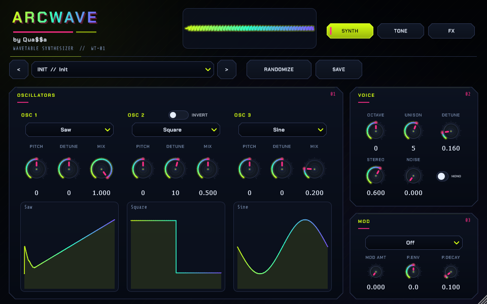

# ArcWave by Qua$$a

**Install (no Git needed):** open the [Releases page](../../releases/latest) and download the ZIP for your system.

- **Windows:** extract `ArcWave-v0.3.0-win64.zip`, run **`install-vst3.bat`** (copies to `C:\Program Files\Common Files\VST3`), or add the extracted folder to FL Studio's VST3 search paths.
- **macOS:** extract `ArcWave-v0.3.0-macos.zip`, run **`./install-macos.sh`** (installs to `~/Library/Audio/Plug-Ins/VST3`), or copy `ArcWave.vst3` there yourself.

Then open FL Studio and use **Options → Manage plugins → Find plugins** to rescan. ArcWave works standalone with its own wavetables; if FL Studio's GMS wavetables are installed, it uses those automatically.

ArcWave is a free (AGPLv3) 64-bit VST3 wavetable synthesizer for Windows and macOS: three
wavetable oscillators, unison, FM/Ring/AM cross-modulation, pitch envelope,
multimode filter, envelopes, LFO, and an FX chain, wrapped in a compact custom
UI with 68 categorized factory presets.



## Features

- **3 wavetable oscillators** with per-osc wave, pitch, detune and mix
- **Unison** up to 8 voices with detune, stereo spread and phase
- **FM / Ring / AM** cross-modulation (OSC 1 modulates OSC 2 and 3)
- **Pitch envelope** for kicks, zaps and percussion
- **TPT state-variable filter** (low/high/band-pass) with cutoff, resonance,
  key tracking and filter envelope
- **Amp ADSR**, filter envelope, LFO
- **FX chain**: drive, crusher, stereo delay, reverb, master gain
- **Soft-clip safety** and a -12 dB default master for headroom
- **Custom UI**: embedded Chakra Petch / Share Tech Mono, holographic dials,
  live scope, per-oscillator waveform previews, output meter
- **Compact 960×600** default window, resizable down to 860×520

## Presets

The preset browser is grouped by category and shows `CATEGORY // NAME`:

- **Init**
- **Bass** — Velvet Sub, Reese Reactor, Acid Filament, Wobble Engine, Growl Bass, Sub Punch, Pluck Bass
- **Leads** — Prism, Neon Wire, Vocal Beacon, Glass Anthem, Screamer, Pure Whistle, Trance, Sync
- **Saws** — Supersaw Anthem, Detuned Saw, Retro Saw, Saw Stack, Saw Pluck, Wide Saw
- **Pads - Ambient** — Aurora, Deep Space, Celestial Choir, Ambient Drift, Frozen Horizon
- **Pads - Bloom** — Bloom Cathedral, Bloom Rising, Bloom Glass, Bloom Choir, Bloom Sub
- **Pads - Textured** — Textured Ice, Grain, Vocal, Metal, Dust
- **Percussion** — Kick 909, Kick Sub, Snare Noise, Hat Closed/Open, Tom Low, Clave, Metallic Hit, Laser Zap
- **Electronic** — EDM Stab, Rave Chord, Techno Pluck, Future Bass, Digital Arp, Trance Pluck
- **FM** — Bell, Bass, Lead, Keys, Growl, Drone
- **Keys** — Velvet Rhodes, Neon Organ, Digital EP, Glass Keys
- **FX** — Riser Engine, Impact Bloom, Downlifter, Noise Sweep, Alien Transmission

## Wavetables

ArcWave loads single-cycle WAV tables in this order:

1. The folder in the `ARCWAVE_WAVETABLES` environment variable, if set.
2. The newest installed FL Studio's GMS `Synth Waves` folder, if found.
3. Otherwise it generates its own original 29-table set at runtime, so the
   plugin still works on machines without FL Studio.

The generated set is also shipped in `assets/wavetables-original/` for reference.
No Image-Line assets are included or redistributed. If you own GMS, ArcWave reads
your local copy only.

## Requirements

- Windows 10/11 x64, or macOS 11+ (universal Apple Silicon/Intel)
- A VST3 host (tested with FL Studio)
- Optional: an FL Studio install with GMS for the GMS wavetables

macOS builds produced by CI are unsigned. If Gatekeeper blocks the plugin,
right-click it and choose Open, or run:

```sh
xattr -dr com.apple.quarantine ~/Library/Audio/Plug-Ins/VST3/ArcWave.vst3
```

Signing and notarization require an Apple Developer account.

## Install without Git

1. Open the [Releases page](../../releases/latest) and download the ZIP for your
   system (`ArcWave-v0.3.0-win64.zip` or `ArcWave-v0.3.0-macos.zip`).
2. Extract the ZIP anywhere.
3. **Windows:** run `install-vst3.bat` (asks for admin), or add the extracted
   folder to your host's VST3 search paths. **macOS:** run `./install-macos.sh`,
   or copy `ArcWave.vst3` to `~/Library/Audio/Plug-Ins/VST3`.
4. In FL Studio: **Options → Manage plugins → Find plugins**.

## Install from the repo

The Windows build is committed at `dist/ArcWave.vst3`. Clone the repo and either
run `install-vst3.bat` (Windows) or `./install-macos.sh` (macOS) from the repo
root, or copy `dist/ArcWave.vst3` to the platform's VST3 folder. You can also add
`dist` to your host's VST3 search paths. macOS binaries are built by GitHub
Actions; see below.

## Build from source

Prerequisites: CMake ≥ 3.22, Visual Studio 2022 Build Tools (MSVC), and Git.

**Windows**

```powershell
git clone https://github.com/fractal-solutions/arcwave-vst.git
cd arcwave
powershell -ExecutionPolicy Bypass -File scripts\build.ps1
```

**macOS**

```sh
git clone https://github.com/fractal-solutions/arcwave-vst.git
cd arcwave
./scripts/build-macos.sh
```

Both scripts fetch JUCE 9.0.4 into `third_party/JUCE/` if missing, build the VST3,
run the headless render test, and stage the bundle in `dist/`. The macOS build is
universal (`arm64;x86_64`) with a deployment target of macOS 11.0.

Manual build (macOS):

```sh
git clone --depth 1 --branch 9.0.4 https://github.com/juce-framework/JUCE.git third_party/JUCE
cmake -S . -B build -G Xcode -DCMAKE_BUILD_TYPE=Release \
  -DCMAKE_OSX_ARCHITECTURES="arm64;x86_64" -DCMAKE_OSX_DEPLOYMENT_TARGET=11.0
cmake --build build --config Release --target ArcWave_VST3 --parallel
```

GitHub Actions (`.github/workflows/build.yml`) builds both platforms on every
push and tag. Pushing a tag like `v0.3.0` also creates a GitHub Release with both
ZIPs attached. JUCE is fetched at build time and is not committed to the repo.

## Reverse-engineering background

ArcWave grew out of a clean-room study of the GMS generator that ships with FL
Studio. The static analysis, recovered parameter vocabulary, wavetable inventory
and `.gmsynth` format notes are in [`analysis/REPORT.md`](analysis/REPORT.md).
ArcWave is an independent implementation: it is not a copy of GMS, does not
include Image-Line code or assets, and is not affiliated with Image-Line.

## License

ArcWave is licensed under the **GNU Affero General Public License v3.0**
(`LICENSE`). Because it links JUCE under JUCE's AGPLv3 option, the source is
provided under AGPLv3. Third-party notices are in
[`THIRD_PARTY_NOTICES.md`](THIRD_PARTY_NOTICES.md).

Fonts: Chakra Petch and Share Tech Mono, SIL Open Font License 1.1.

"GMS", "Groove Machine Synth", "FL Studio" and "Image-Line" are trademarks of
Image-Line. ArcWave is not affiliated with or endorsed by Image-Line.
